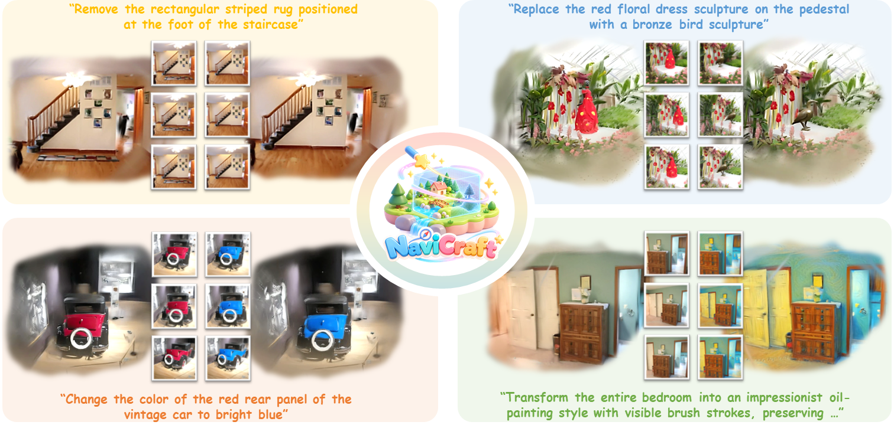

<h3> :medal_military: NaviCraft: Scaling Generalizable 3D Scene Editing in Native 3D Latent Space
</h3>

  <a href="https://yecongwan.github.io/NaviCraft/">🌍 Project Page</a>
  &nbsp;|&nbsp;
  📖 Paper
  &nbsp;|&nbsp;
  🤗 Hugging Face

Yecong Wan, Fan Li, Mingwen Shao, Wangmeng Zuo

  
<table>
  <tr>
    <td>  </td>
  </tr>
</table>

The source code is currently undergoing internal review.
